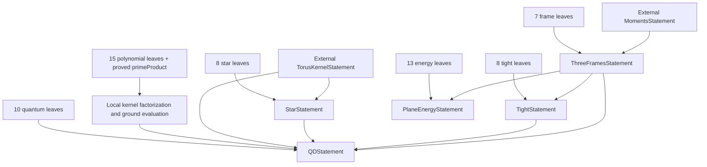

STATUS: COMPLETE

| Open leaf (`AKLT.Blueprint.Q`) | Paper label and sec3 lines | Difficulty | Closed statement content |
|---|---|---|---|
| [OrthogonalFamilyStatement](/home/ubuntu/aklt/wt/BP_Q/AKLT/Blueprint/Q/NodesFrames.lean:25) | `l:threeframes`; 360-369 | easy | Orthogonal maps preserve labelled frame geometry |
| [OneSiteMomentEncodingStatement](/home/ubuntu/aklt/wt/BP_Q/AKLT/Blueprint/Q/NodesFrames.lean:36) | `l:threeframes`; 363-368 | medium | Encode real degree-four polynomials in the one-site product functional |
| [IcoDistanceStatement](/home/ubuntu/aklt/wt/BP_Q/AKLT/Blueprint/Q/NodesFrames.lean:50) | `l:threeframes`; 398-409 | medium | Distinct ico vertices have squared distance greater than one |
| [RotationDisplacementStatement](/home/ubuntu/aklt/wt/BP_Q/AKLT/Blueprint/Q/NodesFrames.lean:55) | `l:threeframes`; 411-417 | easy | Squared displacement bound for T and T^2 |
| [SelfRotationStatement](/home/ubuntu/aklt/wt/BP_Q/AKLT/Blueprint/Q/NodesFrames.lean:61) | `l:threeframes`; 386-396 | medium | Self-rotation bound and exact attainment witness |
| [DisplacedDistanceStatement](/home/ubuntu/aklt/wt/BP_Q/AKLT/Blueprint/Q/NodesFrames.lean:68) | `l:threeframes`; 418-420 | medium | A strict triangle estimate in squared coordinates |
| [RelativeRotationStatement](/home/ubuntu/aklt/wt/BP_Q/AKLT/Blueprint/Q/NodesFrames.lean:76) | `l:threeframes`; 382-384 | medium | Reduce pairs of distinct frames to exponent differences 1 or 2 |
| [SpinorChoiceStatement](/home/ubuntu/aklt/wt/BP_Q/AKLT/Blueprint/Q/NodesTight.lean:12) | `d:poly`; 68-73 | medium | Explicit finite spinor chart satisfies norm and density identities |
| [QuarticKernelDegreeStatement](/home/ubuntu/aklt/wt/BP_Q/AKLT/Blueprint/Q/NodesTight.lean:17) | `l:tight`; 287-298 | easy | Every explicit complex kernel has total degree at most four |
| [QuarticKernelEvaluationStatement](/home/ubuntu/aklt/wt/BP_Q/AKLT/Blueprint/Q/NodesTight.lean:22) | `l:tight`; 287-297 | medium | Spinor monomial products equal degree-four density kernels |
| [ComplexQuadratureStatement](/home/ubuntu/aklt/wt/BP_Q/AKLT/Blueprint/Q/NodesTight.lean:29) | `d:frame`; 271-272 | medium | Complexify any finite real quadrature |
| [QuarticOffDiagonalStatement](/home/ubuntu/aklt/wt/BP_Q/AKLT/Blueprint/Q/NodesTight.lean:37) | `l:tight`; 298-302 | medium | Off-diagonal kernel averages vanish |
| [QuarticDiagonalStatement](/home/ubuntu/aklt/wt/BP_Q/AKLT/Blueprint/Q/NodesTight.lean:42) | `l:tight`; 304-318 | easy | Five diagonal averages have exact inverse-binomial norms |
| [ResolutionExpansionStatement](/home/ubuntu/aklt/wt/BP_Q/AKLT/Blueprint/Q/NodesTight.lean:47) | `l:tight`; 319-326 | easy | A resolved Gram matrix gives the one-site norm identity |
| [TensorResolutionStatement](/home/ubuntu/aklt/wt/BP_Q/AKLT/Blueprint/Q/NodesTight.lean:55) | `l:tight`; 328-333 | medium | Tensorize local Gram resolutions on the frozen torus Hilbert space |
| [StarPositiveStatement](/home/ubuntu/aklt/wt/BP_Q/AKLT/Blueprint/Q/NodesStar.lean:11) | `l:star`; 235-236 | easy | Fixed-star Hamiltonian is symmetric and positive |
| [StarWitnessStatement](/home/ubuntu/aklt/wt/BP_Q/AKLT/Blueprint/Q/NodesStar.lean:16) | `l:star`; 236-240 | medium | Four is an eigenvalue of the fixed star |
| [PositiveSpectralMinimumStatement](/home/ubuntu/aklt/wt/BP_Q/AKLT/Blueprint/Q/NodesStar.lean:21) | `l:star`; 240-241 | medium | Positive spectrum has an attained positive infimum |
| [SpectralKernelCoercivityStatement](/home/ubuntu/aklt/wt/BP_Q/AKLT/Blueprint/Q/NodesStar.lean:31) | `l:star`; 242-243 | medium | Spectral lower bound gives coercivity away from the full kernel |
| [StarAmplificationStatement](/home/ubuntu/aklt/wt/BP_Q/AKLT/Blueprint/Q/NodesStar.lean:48) | `l:star`; 249-250 | medium | Transport coercivity through spectator amplification |
| [StateEvaluationStatement](/home/ubuntu/aklt/wt/BP_Q/AKLT/Blueprint/Q/NodesPolynomial.lean:11) | `d:poly`; 74-76; 575-578 | medium | Physical polynomial evaluation matches frozen normalized coordinates |
| [VbsHomogeneityStatement](/home/ubuntu/aklt/wt/BP_Q/AKLT/Blueprint/Q/NodesPolynomial.lean:18) | `p:toruskernel`; 199-205 | medium | VBS polynomial has degree four at every torus site |
| [CoefficientReconstructionStatement](/home/ubuntu/aklt/wt/BP_Q/AKLT/Blueprint/Q/NodesPolynomial.lean:24) | `d:poly`; 16-18; 202-205; 583-588 | medium | Reconstruct a homogeneous polynomial from its physical coordinates |
| [PairDiagonalDivisionStatement](/home/ubuntu/aklt/wt/BP_Q/AKLT/Blueprint/Q/NodesPolynomial.lean:38) | `l:edge`; 100-109 | hard | Diagonal vanishing implies determinant divisibility for the fixed pair |
| [SpectatorDivisibilityStatement](/home/ubuntu/aklt/wt/BP_Q/AKLT/Blueprint/Q/NodesPolynomial.lean:44) | `l:edge`; 128-134 | hard | Transfer the pair kernel implication to a torus edge |
| [SingletNonassociateStatement](/home/ubuntu/aklt/wt/BP_Q/AKLT/Blueprint/Q/NodesPolynomial.lean:57) | `l:divisibility`; 167-170 | medium | Distinct frozen edge determinants are nonassociate |
| [IncidentKernelStatement](/home/ubuntu/aklt/wt/BP_Q/AKLT/Blueprint/Q/NodesPolynomial.lean:70) | `l:quantumfibre`; 625-626 | easy | A zero star sum annihilates each incident projector |
| [PairDiagonalRankStatement](/home/ubuntu/aklt/wt/BP_Q/AKLT/Blueprint/Q/NodesSplits.lean:15) | `l:edge`; 93-101 | medium | The pair diagonal kernel has dimension sixteen |
| [PairTopInclusionStatement](/home/ubuntu/aklt/wt/BP_Q/AKLT/Blueprint/Q/NodesSplits.lean:19) | `l:edge`; 112-117 | medium | Diagonal-kernel orthogonal complement lies in the spin-four space |
| [PairTopDimensionStatement](/home/ubuntu/aklt/wt/BP_Q/AKLT/Blueprint/Q/NodesSplits.lean:25) | `l:edge`; 118-124 | medium | The pair Casimir eigenvalue-twenty space has dimension nine |
| [FourVariableDeterminantPrimeStatement](/home/ubuntu/aklt/wt/BP_Q/AKLT/Blueprint/Q/NodesSplits.lean:31) | `l:divisibility`; 154-165 | hard | The determinant in four independent complex variables is prime |
| [DeterminantPrimeEmbeddingStatement](/home/ubuntu/aklt/wt/BP_Q/AKLT/Blueprint/Q/NodesSplits.lean:38) | `l:divisibility`; 154-165 | medium | Preserve determinant primality after adjoining spectator variables |
| [CentreDegreeCancellationStatement](/home/ubuntu/aklt/wt/BP_Q/AKLT/Blueprint/Q/NodesSplits.lean:47) | `l:divisibility`; 176-188 | hard | Centre degree saturation forces an independent residual |
| [IncidentProductDegreeStatement](/home/ubuntu/aklt/wt/BP_Q/AKLT/Blueprint/Q/NodesSplits.lean:55) | `l:divisibility`; 147-152; 178-186 | medium | The incident product is nonzero and has centre degree four |
| [StateCentreDegreeStatement](/home/ubuntu/aklt/wt/BP_Q/AKLT/Blueprint/Q/NodesSplits.lean:61) | `d:poly`; 74-76; 176-182 | easy | Every physical state polynomial has centre degree four |
| [StarEdgeEnumerationStatement](/home/ubuntu/aklt/wt/BP_Q/AKLT/Blueprint/Q/NodesSplits.lean:76) | `l:star`; 245-252 | easy | Enumerate the four incident oriented bond indices |
| [StarCasimirChartStatement](/home/ubuntu/aklt/wt/BP_Q/AKLT/Blueprint/Q/NodesSplits.lean:83) | `l:star`; 245-249 | hard | Build a five-site coordinate chart transporting the four Casimirs |
| [StarProjectorTransportStatement](/home/ubuntu/aklt/wt/BP_Q/AKLT/Blueprint/Q/NodesSplits.lean:91) | `l:star`; 245-250 | medium | Transport the four pair eigenspace projectors through the Casimir chart |
| [DeterminantModulusStatement](/home/ubuntu/aklt/wt/BP_Q/AKLT/Blueprint/Q/NodesQuantum.lean:11) | `l:qmod`; 458-485 | easy | Squared spinor determinant equals (1-dot)/2 |
| [GroundProductWeightStatement](/home/ubuntu/aklt/wt/BP_Q/AKLT/Blueprint/Q/NodesQuantum.lean:17) | `e:frame-ground-weight`; 583-588 | easy | Multiply bond moduli with the unnormalized reference weight |
| [IncidentEvaluationStatement](/home/ubuntu/aklt/wt/BP_Q/AKLT/Blueprint/Q/NodesQuantum.lean:33) | `l:quantumfibre`; 570-579; 627-631 | medium | Signed residual evaluation lies in the beta fibre span |
| [GroundFibreFactorizationStatement](/home/ubuntu/aklt/wt/BP_Q/AKLT/Blueprint/Q/NodesQuantum.lean:44) | `l:quantumfibre`; 570-579 | medium | Separate B into signed beta and exterior rho |
| [GroundTransformStatement](/home/ubuntu/aklt/wt/BP_Q/AKLT/Blueprint/Q/NodesQuantum.lean:56) | `l:quantumfibre`; 595-598 | easy | Weighted multiplication has the explicit inverse and preserves norm |
| [FibreIntertwiningStatement](/home/ubuntu/aklt/wt/BP_Q/AKLT/Blueprint/Q/NodesQuantum.lean:69) | `l:quantumfibre`; 600-623; 674-676 | medium | Intertwine conditional expectation and beta projection, including residual norms |
| [FibreProjectionStatement](/home/ubuntu/aklt/wt/BP_Q/AKLT/Blueprint/Q/NodesQuantum.lean:87) | `l:quantumfibre`; 609-620; 634-643 | medium | The beta quotient is an orthogonal best approximation |
| [WeightedPolarizationStatement](/home/ubuntu/aklt/wt/BP_Q/AKLT/Blueprint/Q/NodesQuantum.lean:100) | `t:QD`; 660-667 | easy | Polarize a linear weighted norm isometry |
| [GroundQuotientVarianceStatement](/home/ubuntu/aklt/wt/BP_Q/AKLT/Blueprint/Q/NodesQuantum.lean:109) | `t:QD`; 660-667 | easy | The orthogonal physical vector quotient has mean zero and correct variance |
| [BetaNonzeroStatement](/home/ubuntu/aklt/wt/BP_Q/AKLT/Blueprint/Q/NodesQuantum.lean:124) | `l:quantumfibre`; 541-544; 595; 609 | easy | Positive oriented determinant moduli make each beta nonzero |
| [FrameWeightsPositiveStatement](/home/ubuntu/aklt/wt/BP_Q/AKLT/Blueprint/Q/NodesEnergy.lean:11) | `d:framemodel`; 519-524 | easy | Both signs of proper frame weights are strictly positive |
| [PlaneConditioningStatement](/home/ubuntu/aklt/wt/BP_Q/AKLT/Blueprint/Q/NodesEnergy.lean:27) | `l:planeenergy`; 709-719 | medium | Plane laws condition consistently on every subvolume |
| [TorusMarkovStatement](/home/ubuntu/aklt/wt/BP_Q/AKLT/Blueprint/Q/NodesEnergy.lean:35) | `l:planeenergy`; 709-719 | medium | Torus conditional laws depend only on exterior nearest neighbours |
| [PlaneOneSiteEnergyStatement](/home/ubuntu/aklt/wt/BP_Q/AKLT/Blueprint/Q/NodesEnergy.lean:45) | `l:planeenergy`; 721-730 | medium | Uniform plane one-site letter probability lower bound |
| [TorusOneSiteEnergyStatement](/home/ubuntu/aklt/wt/BP_Q/AKLT/Blueprint/Q/NodesEnergy.lean:53) | `l:planeenergy`; 721-730 | medium | Uniform antiferromagnetic torus one-site letter bound |
| [PartialAssignmentStatement](/home/ubuntu/aklt/wt/BP_Q/AKLT/Blueprint/Q/NodesEnergy.lean:62) | `l:planeenergy`; 732-745 | medium | Average one-site bounds and multiply along distinct prescribed sites |
| [PlaneAssignmentReindexStatement](/home/ubuntu/aklt/wt/BP_Q/AKLT/Blueprint/Q/NodesEnergy.lean:74) | `l:planeenergy`; 736-744 | easy | Move physical subsets to the volume subtype without changing cardinality |
| [PlaneProductReferenceStatement](/home/ubuntu/aklt/wt/BP_Q/AKLT/Blueprint/Q/NodesEnergy.lean:86) | `l:planeenergy`; 747-759 | medium | Normalize positive boundary endpoint weights to a product law |
| [BoundaryAbsorptionStatement](/home/ubuntu/aklt/wt/BP_Q/AKLT/Blueprint/Q/NodesEnergy.lean:95) | `l:planeenergy`; 760-765 | medium | Only internal edge factors remain in the density relative to the product law |
| [PlaneDensityBoundsStatement](/home/ubuntu/aklt/wt/BP_Q/AKLT/Blueprint/Q/NodesEnergy.lean:104) | `l:planeenergy`; 764-770; 784-786 | medium | Positive internal density bounds and the exact single ratio |
| [DensityVarianceStatement](/home/ubuntu/aklt/wt/BP_Q/AKLT/Blueprint/Q/NodesEnergy.lean:118) | `l:density`; sec3 772-782; Appendix A l:density | easy | Density comparison for complex variance |
| [DensityDirichletStatement](/home/ubuntu/aklt/wt/BP_Q/AKLT/Blueprint/Q/NodesEnergy.lean:126) | `l:density`; sec3 779-780; Appendix A l:density | medium | Single-ratio comparison of integrated conditional variance |
| [ProductPoincareStatement](/home/ubuntu/aklt/wt/BP_Q/AKLT/Blueprint/Q/NodesEnergy.lean:135) | `l:density`; sec3 779-782; Appendix A l:density | medium | Product-law Poincare inequality at rate one per site |

61 open leaves. Every row is a closed `def …Statement : Prop`, with a paper reference and proof idea in its docstring. The [machine manifest](/home/ubuntu/aklt/reports/BP_Q/leaves.json) contains each exact Lean-printed closed statement, original source declaration and context, module, source line, definition/library dependencies, donor pointers, proof-size estimate, route, individual trap review, and required first-attempt routing. No open leaf is asserted as a theorem.

## Proved and derived nodes

| Node | Status and exported theorem |
|---|---|
| `RotationStatement` | Proved: `rotation : RotationStatement` |
| `RotationPowersStatement` | Proved: `rotationPowers : RotationPowersStatement` |
| `FrameScalarsStatement` | Proved: `frameScalars : FrameScalarsStatement` |
| `IncidentDoubleCountStatement` | Proved: `incidentDoubleCount : IncidentDoubleCountStatement` |
| `PositiveNormalizationStatement` | Proved: `positiveNormalization : PositiveNormalizationStatement` |
| `PrimeProductStatement` | Proved: `primeProduct : PrimeProductStatement` |
| `PairSpinFourStatement` | Derived from smaller nodes: `pairSpinFour_of_leaves` |
| `SingletPrimeStatement` | Derived from smaller nodes: `singletPrime_of_leaves` |
| `IncidentDegreeStatement` | Derived from smaller nodes: `incidentDegree_of_leaves` |
| `StarRelabellingStatement` | Derived from smaller nodes: `starRelabelling_of_leaves` |

The four derived nodes are not writer assignments and do not occur in leaves.json. Their smaller leaves occur exactly once in the orchestration bundles. The six proved nodes are also excluded from leaves.json.

## Author rule on first proof attempts

The resumed orchestrator message requires every new leaf proof attempt, including a short proof or checker soundness proof, to start with a different, cheaper model. The blueprint author may continue statements, definitions, designs, checkers, data exporters, measurements, prototypes, and proved assembly theorems. This rule is now recorded in [proof-policy.json](/home/ubuntu/aklt/reports/BP_Q/proof-policy.json) and in the first_attempt field of every open manifest entry. Model assignment remains with the orchestrator; no new leaf proof was attempted during this resumed turn.

The following proofs predate the rule and are retained. The first six are the named leaf proofs already counted above; the normalization helper and definition-field obligations are listed separately so no existing proof is hidden by its file placement.

| Existing declaration | Pre-rule proof retained |
|---|---|
| [AKLT.Blueprint.Q.rotation](/home/ubuntu/aklt/wt/BP_Q/AKLT/Blueprint/Q/NodesFrames.lean:82) | Named leaf proof |
| [AKLT.Blueprint.Q.rotationPowers](/home/ubuntu/aklt/wt/BP_Q/AKLT/Blueprint/Q/NodesFrames.lean:89) | Named leaf proof |
| [AKLT.Blueprint.Q.frameScalars](/home/ubuntu/aklt/wt/BP_Q/AKLT/Blueprint/Q/NodesFrames.lean:101) | Named leaf proof |
| [AKLT.Blueprint.Q.incidentDoubleCount](/home/ubuntu/aklt/wt/BP_Q/AKLT/Blueprint/Q/NodesStar.lean:59) | Named leaf proof |
| [AKLT.Blueprint.Q.positiveNormalization](/home/ubuntu/aklt/wt/BP_Q/AKLT/Blueprint/Q/NodesEnergy.lean:140) | Named leaf proof |
| [AKLT.Blueprint.Q.primeProduct](/home/ubuntu/aklt/wt/BP_Q/AKLT/Blueprint/Q/NodesPolynomial.lean:81) | Named leaf proof |
| [AKLT.Blueprint.Q.normalize_from_scaled](/home/ubuntu/aklt/wt/BP_Q/AKLT/Blueprint/Q/Assembly.lean:261) | Generic scaled-normalization helper; already proved before the rule |
| [AKLT.Blueprint.Q.coherentMap](/home/ubuntu/aklt/wt/BP_Q/AKLT/Blueprint/Q/Definitions.lean:62) | Existing map_add and map_smul proof fields inside a definition |
| [AKLT.Blueprint.Q.pairDiagonal](/home/ubuntu/aklt/wt/BP_Q/AKLT/Blueprint/Q/Definitions.lean:107) | Existing map_add and map_smul proof fields inside a definition |

All 61 open leaves remain open, with exact closed statements in leaves.json. The existing 14 composition theorems and the pre-rule normalization helper remain in Assembly.lean. No mathematical checker or new checker-soundness proof is part of this blueprint; verify.py checks existing builds, declarations, axiom output and report data. Lean source content and the existing axiom audit are unchanged by this policy/report update.

## Files

| File | Contents |
|---|---|
| [Definitions.lean](/home/ubuntu/aklt/wt/BP_Q/AKLT/Blueprint/Q/Definitions.lean) | Spinor compatibility and kernels; physical/pair polynomials; weighted norms; signed beta/rho and fibre projection; boundary-absorbed product reference. |
| [NodesFrames.lean](/home/ubuntu/aklt/wt/BP_Q/AKLT/Blueprint/Q/NodesFrames.lean) | Frame geometry, moment encoding, separation and attained bound; rational rotation and scalar proofs. |
| [NodesTight.lean](/home/ubuntu/aklt/wt/BP_Q/AKLT/Blueprint/Q/NodesTight.lean) | Spinor verification, complex degree-four kernels, local Gram expansion, tensorization. |
| [NodesStar.lean](/home/ubuntu/aklt/wt/BP_Q/AKLT/Blueprint/Q/NodesStar.lean) | Fixed-star positivity, nonempty spectrum, spectral minimum, coercivity and amplification; proved multiplicity-two count. |
| [NodesPolynomial.lean](/home/ubuntu/aklt/wt/BP_Q/AKLT/Blueprint/Q/NodesPolynomial.lean) | Physical polynomial evaluation/reconstruction, pair divisibility, spectators, nonassociation, and local kernel facts; proved finite prime product. |
| [NodesQuantum.lean](/home/ubuntu/aklt/wt/BP_Q/AKLT/Blueprint/Q/NodesQuantum.lean) | Determinant modulus, signed factorization, weighted ground transform, fibre projection and intertwining, quotient variance. |
| [NodesEnergy.lean](/home/ubuntu/aklt/wt/BP_Q/AKLT/Blueprint/Q/NodesEnergy.lean) | Positive weights, consistent conditioning, Markov dependence, finite energy, partial assignments, product-reference density comparison; proved positive normalization. |
| [NodesSplits.lean](/home/ubuntu/aklt/wt/BP_Q/AKLT/Blueprint/Q/NodesSplits.lean) | Second split of pair spin identification, determinant primality, centre-degree cancellation, and star relabelling. |
| [Assembly.lean](/home/ubuntu/aklt/wt/BP_Q/AKLT/Blueprint/Q/Assembly.lean) | 15 proved composition/helper theorems, six closed conjunction bundles, and the full five-target theorem. |
| [All.lean](/home/ubuntu/aklt/wt/BP_Q/AKLT/Blueprint/Q/All.lean) | Import entry point. |
| [Audit.lean](/home/ubuntu/aklt/wt/BP_Q/AKLT/Blueprint/Q/Audit.lean) | 71 closedness checks and all 21 exported theorem axiom checks. |
| [leaves.json](/home/ubuntu/aklt/reports/BP_Q/leaves.json) | 61 open assignments, exact closed statements, first-attempt routing and individual trap checks. |
| [proof-policy.json](/home/ubuntu/aklt/reports/BP_Q/proof-policy.json) | Author rule, retained pre-rule proof inventory, declaration digests and unchanged Lean source snapshot. |
| [exported-declarations.txt](/home/ubuntu/aklt/reports/BP_Q/exported-declarations.txt) | Lean-printed statement definitions, bundles, and all exported theorem signatures. |
| [axioms.txt](/home/ubuntu/aklt/reports/BP_Q/axioms.txt) | Verbatim axiom output for all 21 theorems. |
| [verification.json](/home/ubuntu/aklt/reports/BP_Q/verification.json) | Machine-readable validation result. |
| [build-results.json](/home/ubuntu/aklt/reports/BP_Q/build-results.json) | Exact build commands, timings, exit codes and logs. |
| [verify.py](/home/ubuntu/aklt/reports/BP_Q/verify.py) | Reproducible direct-Lean verification, dependency ordered, at most four Lean processes. |
| [prepare.py](/home/ubuntu/aklt/reports/BP_Q/prepare.py) | Recreates manifest and audit files from checked node sources plus routing metadata. |

## Assembly statements and dependency graph

The public target theorems are `threeFrames_of_leaves`, `tight_of_leaves`, `star_of_leaves`, `qd_of_leaves`, and `planeEnergy_of_leaves`. They conclude the existing Top declarations without modifying them. The fully composed theorem has this type:

```lean
AKLT.Blueprint.Q.allTargets_of_leaves
  (hMom : AKLT.Blueprint.Top.MomentsStatement)
  (hKernel : AKLT.Blueprint.Top.TorusKernelStatement)
  (hFrames : AKLT.Blueprint.Q.FramesInputs)
  (hTight : AKLT.Blueprint.Q.TightInputs)
  (hStar : AKLT.Blueprint.Q.StarInputs)
  (hPoly : AKLT.Blueprint.Q.PolynomialInputs)
  (hQuantum : AKLT.Blueprint.Q.QuantumInputs)
  (hEnergy : AKLT.Blueprint.Q.EnergyInputs) :
  AKLT.Blueprint.Top.ThreeFramesStatement ∧
  AKLT.Blueprint.Top.TightStatement ∧
  AKLT.Blueprint.Top.StarStatement ∧
  AKLT.Blueprint.Top.QDStatement ∧
  AKLT.Blueprint.Top.PlaneEnergyStatement
```

Every hypothesis in this target assembly is a closed Prop. The six `…Inputs` definitions are transparent conjunctions of the 61 open leaves, not new hypotheses hidden in structures or instances. No other external Top result is needed.



The QD assembly derives the density identity by summing the raw product weight with the physical isometry. For an orthogonal vector it forms the explicit ground quotient, proves its variance is the physical norm squared, transports each one-site Dirichlet term to a beta projection residual, applies the local kernel inclusion, and sums the star coercivity bounds. The last arithmetic step is proved for every real Poincare lower bound gamma; it does not add gamma>0.

The finite-energy assembly first extracts the numerical two-sign `interactionBounds` from ThreeFramesStatement. Its finite-model leaves take those explicit bounds as a mathematical premise, so their writers do not repeat the geometric separation proof. The block comparison keeps every boundary factor inside the positive product reference, compares unnormalized conditional-variance minima, and cancels the common interaction mean once, giving exactly r_b^(number of internal bonds).

All exported theorem signatures, including every explicit hypothesis, follow verbatim from Lean:

```text
AKLT.Blueprint.Q.threeFrames_of_leaves (hMom : AKLT.Blueprint.Top.MomentsStatement)
  (hFamily : AKLT.Blueprint.Q.OrthogonalFamilyStatement) (hEncoding : AKLT.Blueprint.Q.OneSiteMomentEncodingStatement)
  (hDistance : AKLT.Blueprint.Q.IcoDistanceStatement) (hDisplacement : AKLT.Blueprint.Q.RotationDisplacementStatement)
  (hSelf : AKLT.Blueprint.Q.SelfRotationStatement) (hMetric : AKLT.Blueprint.Q.DisplacedDistanceStatement)
  (hRelative : AKLT.Blueprint.Q.RelativeRotationStatement) : AKLT.Blueprint.Top.ThreeFramesStatement
AKLT.Blueprint.Q.resolution_of_leaves (hDegree : AKLT.Blueprint.Q.QuarticKernelDegreeStatement)
  (hEval : AKLT.Blueprint.Q.QuarticKernelEvaluationStatement) (hComplex : AKLT.Blueprint.Q.ComplexQuadratureStatement)
  (hOff : AKLT.Blueprint.Q.QuarticOffDiagonalStatement) (hDiag : AKLT.Blueprint.Q.QuarticDiagonalStatement) (A : Type)
  [Fintype A] (v : A → AKLT.Defs.Vec3) (w : A → ℝ) :
  AKLT.Blueprint.Q.quadrature v w →
    ∀ (z : A → AKLT.Defs.Spinor), (∀ (a : A), AKLT.Blueprint.Q.compatible (v a) (z a)) → AKLT.Blueprint.Q.resolution w z
AKLT.Blueprint.Q.tight_of_leaves (hThree : AKLT.Blueprint.Top.ThreeFramesStatement)
  (hChoice : AKLT.Blueprint.Q.SpinorChoiceStatement) (hDegree : AKLT.Blueprint.Q.QuarticKernelDegreeStatement)
  (hEval : AKLT.Blueprint.Q.QuarticKernelEvaluationStatement) (hComplex : AKLT.Blueprint.Q.ComplexQuadratureStatement)
  (hOff : AKLT.Blueprint.Q.QuarticOffDiagonalStatement) (hDiag : AKLT.Blueprint.Q.QuarticDiagonalStatement)
  (hExpansion : AKLT.Blueprint.Q.ResolutionExpansionStatement) (hTensor : AKLT.Blueprint.Q.TensorResolutionStatement) :
  AKLT.Blueprint.Top.TightStatement
AKLT.Blueprint.Q.star_of_leaves (hKernel : AKLT.Blueprint.Top.TorusKernelStatement)
  (hPositive : AKLT.Blueprint.Q.StarPositiveStatement) (hWitness : AKLT.Blueprint.Q.StarWitnessStatement)
  (hMinimum : AKLT.Blueprint.Q.PositiveSpectralMinimumStatement)
  (hCoercive : AKLT.Blueprint.Q.SpectralKernelCoercivityStatement)
  (hRelabel : AKLT.Blueprint.Q.StarRelabellingStatement) (hAmplify : AKLT.Blueprint.Q.StarAmplificationStatement) :
  AKLT.Blueprint.Top.StarStatement
AKLT.Blueprint.Q.density_poincare_of_leaves (hVar : AKLT.Blueprint.Q.DensityVarianceStatement)
  (hDir : AKLT.Blueprint.Q.DensityDirichletStatement) (ι : Type) [Fintype ι] [DecidableEq ι] (S : ι → Type)
  (x✝ : (x : ι) → Fintype (S x)) (p q : AKLT.Defs.Weight ((x : ι) → S x)) :
  AKLT.Defs.PositiveProbability p →
    AKLT.Defs.PositiveProbability q →
      AKLT.Defs.PoincareLower p 1 →
        ∀ (m M : ℝ),
          0 < m →
            0 < M →
              (∀ (σ : (x : ι) → S x), m * p σ ≤ q σ) →
                (∀ (σ : (x : ι) → S x), q σ ≤ M * p σ) → AKLT.Defs.PoincareLower q (m / M)
AKLT.Blueprint.Q.planeEnergy_of_leaves (hThree : AKLT.Blueprint.Top.ThreeFramesStatement)
  (hWeights : AKLT.Blueprint.Q.FrameWeightsPositiveStatement) (hCondition : AKLT.Blueprint.Q.PlaneConditioningStatement)
  (hMarkov : AKLT.Blueprint.Q.TorusMarkovStatement) (hPlaneSite : AKLT.Blueprint.Q.PlaneOneSiteEnergyStatement)
  (hTorusSite : AKLT.Blueprint.Q.TorusOneSiteEnergyStatement) (hPartial : AKLT.Blueprint.Q.PartialAssignmentStatement)
  (hReindex : AKLT.Blueprint.Q.PlaneAssignmentReindexStatement)
  (hReference : AKLT.Blueprint.Q.PlaneProductReferenceStatement)
  (hAbsorb : AKLT.Blueprint.Q.BoundaryAbsorptionStatement) (hBounds : AKLT.Blueprint.Q.PlaneDensityBoundsStatement)
  (hVar : AKLT.Blueprint.Q.DensityVarianceStatement) (hDir : AKLT.Blueprint.Q.DensityDirichletStatement)
  (hProduct : AKLT.Blueprint.Q.ProductPoincareStatement) : AKLT.Blueprint.Top.PlaneEnergyStatement
AKLT.Blueprint.Q.localKernelFactorization_of_leaves (hPair : AKLT.Blueprint.Q.PairSpinFourStatement)
  (hDivision : AKLT.Blueprint.Q.PairDiagonalDivisionStatement)
  (hSpectator : AKLT.Blueprint.Q.SpectatorDivisibilityStatement) (hPrime : AKLT.Blueprint.Q.SingletPrimeStatement)
  (hNonassoc : AKLT.Blueprint.Q.SingletNonassociateStatement) (hProduct : AKLT.Blueprint.Q.PrimeProductStatement)
  (hIncident : AKLT.Blueprint.Q.IncidentKernelStatement) (hDegree : AKLT.Blueprint.Q.IncidentDegreeStatement)
  (L N : AKLT.Challenge.Size) (x : AKLT.Challenge.Site L N) (ψ : AKLT.Challenge.Hilbert L N) :
  (AKLT.Defs.siteHamiltonian x) ψ = 0 →
    ∃ χ,
      AKLT.Blueprint.Q.statePolynomial ψ = AKLT.Blueprint.Q.incidentProduct x * χ ∧ AKLT.Blueprint.Q.independentAt x χ
AKLT.Blueprint.Q.groundEvaluation_of_leaves (hEval : AKLT.Blueprint.Q.StateEvaluationStatement)
  (hHom : AKLT.Blueprint.Q.VbsHomogeneityStatement) (hReconstruct : AKLT.Blueprint.Q.CoefficientReconstructionStatement)
  (L N : AKLT.Challenge.Size) (κ : AKLT.Challenge.Site L N → Fin 3) (σ : AKLT.Defs.TorusConfiguration L N) :
  AKLT.Defs.frameEval κ (AKLT.Challenge.B L N) σ =
    ∏ e,
      AKLT.Blueprint.Q.determinant (AKLT.Defs.frameSpinor (κ e.1) (σ e.1))
        (AKLT.Defs.frameSpinor (κ (AKLT.Challenge.nextSite e.1 e.2)) (σ (AKLT.Challenge.nextSite e.1 e.2)))
AKLT.Blueprint.Q.normalize_from_scaled (Ω : Type) [Fintype Ω] (w r : AKLT.Defs.Weight Ω) (c n : ℝ) :
  0 < c → 0 < n → (∀ (σ : Ω), r σ = c * w σ) → ∑ σ, r σ = n → AKLT.Defs.normalize w = fun σ => r σ / n
AKLT.Blueprint.Q.qd_of_leaves (hThree : AKLT.Blueprint.Top.ThreeFramesStatement)
  (hTight : AKLT.Blueprint.Top.TightStatement) (hStar : AKLT.Blueprint.Top.StarStatement)
  (hKernel : AKLT.Blueprint.Top.TorusKernelStatement) (hEval : AKLT.Blueprint.Q.StateEvaluationStatement)
  (hHom : AKLT.Blueprint.Q.VbsHomogeneityStatement) (hReconstruct : AKLT.Blueprint.Q.CoefficientReconstructionStatement)
  (hPair : AKLT.Blueprint.Q.PairSpinFourStatement) (hDivision : AKLT.Blueprint.Q.PairDiagonalDivisionStatement)
  (hSpectator : AKLT.Blueprint.Q.SpectatorDivisibilityStatement) (hPrime : AKLT.Blueprint.Q.SingletPrimeStatement)
  (hNonassoc : AKLT.Blueprint.Q.SingletNonassociateStatement) (hProduct : AKLT.Blueprint.Q.PrimeProductStatement)
  (hIncident : AKLT.Blueprint.Q.IncidentKernelStatement) (hDegree : AKLT.Blueprint.Q.IncidentDegreeStatement)
  (hModulus : AKLT.Blueprint.Q.DeterminantModulusStatement) (hWeight : AKLT.Blueprint.Q.GroundProductWeightStatement)
  (hLocalEval : AKLT.Blueprint.Q.IncidentEvaluationStatement)
  (hFactor : AKLT.Blueprint.Q.GroundFibreFactorizationStatement)
  (hTransform : AKLT.Blueprint.Q.GroundTransformStatement) (hIntertwine : AKLT.Blueprint.Q.FibreIntertwiningStatement)
  (hProjection : AKLT.Blueprint.Q.FibreProjectionStatement) (hPolar : AKLT.Blueprint.Q.WeightedPolarizationStatement)
  (hVariance : AKLT.Blueprint.Q.GroundQuotientVarianceStatement) (hBeta : AKLT.Blueprint.Q.BetaNonzeroStatement) :
  AKLT.Blueprint.Top.QDStatement
AKLT.Blueprint.Q.pairSpinFour_of_leaves (hRank : AKLT.Blueprint.Q.PairDiagonalRankStatement)
  (hInclusion : AKLT.Blueprint.Q.PairTopInclusionStatement) (hDimension : AKLT.Blueprint.Q.PairTopDimensionStatement) :
  AKLT.Blueprint.Q.PairSpinFourStatement
AKLT.Blueprint.Q.singletPrime_of_leaves (hFour : AKLT.Blueprint.Q.FourVariableDeterminantPrimeStatement)
  (hEmbed : AKLT.Blueprint.Q.DeterminantPrimeEmbeddingStatement) : AKLT.Blueprint.Q.SingletPrimeStatement
AKLT.Blueprint.Q.incidentDegree_of_leaves (hCancellation : AKLT.Blueprint.Q.CentreDegreeCancellationStatement)
  (hProduct : AKLT.Blueprint.Q.IncidentProductDegreeStatement) (hState : AKLT.Blueprint.Q.StateCentreDegreeStatement) :
  AKLT.Blueprint.Q.IncidentDegreeStatement
AKLT.Blueprint.Q.starRelabelling_of_leaves (hEnumeration : AKLT.Blueprint.Q.StarEdgeEnumerationStatement)
  (hChart : AKLT.Blueprint.Q.StarCasimirChartStatement)
  (hTransport : AKLT.Blueprint.Q.StarProjectorTransportStatement) : AKLT.Blueprint.Q.StarRelabellingStatement
AKLT.Blueprint.Q.allTargets_of_leaves (hMom : AKLT.Blueprint.Top.MomentsStatement)
  (hKernel : AKLT.Blueprint.Top.TorusKernelStatement) (hFrames : AKLT.Blueprint.Q.FramesInputs)
  (hTight : AKLT.Blueprint.Q.TightInputs) (hStar : AKLT.Blueprint.Q.StarInputs)
  (hPoly : AKLT.Blueprint.Q.PolynomialInputs) (hQuantum : AKLT.Blueprint.Q.QuantumInputs)
  (hEnergy : AKLT.Blueprint.Q.EnergyInputs) :
  AKLT.Blueprint.Top.ThreeFramesStatement ∧
    AKLT.Blueprint.Top.TightStatement ∧
      AKLT.Blueprint.Top.StarStatement ∧ AKLT.Blueprint.Top.QDStatement ∧ AKLT.Blueprint.Top.PlaneEnergyStatement
AKLT.Blueprint.Q.positiveNormalization : AKLT.Blueprint.Q.PositiveNormalizationStatement
AKLT.Blueprint.Q.rotation : AKLT.Blueprint.Q.RotationStatement
AKLT.Blueprint.Q.rotationPowers : AKLT.Blueprint.Q.RotationPowersStatement
AKLT.Blueprint.Q.frameScalars : AKLT.Blueprint.Q.FrameScalarsStatement
AKLT.Blueprint.Q.primeProduct : AKLT.Blueprint.Q.PrimeProductStatement
AKLT.Blueprint.Q.incidentDoubleCount : AKLT.Blueprint.Q.IncidentDoubleCountStatement
```

## #print axioms

Verbatim output of the commands in Audit.lean, including every assembly theorem and every immediate proof:

```text
'AKLT.Blueprint.Q.threeFrames_of_leaves' depends on axioms: [propext, Classical.choice, Quot.sound]
'AKLT.Blueprint.Q.resolution_of_leaves' depends on axioms: [propext, Classical.choice, Quot.sound]
'AKLT.Blueprint.Q.tight_of_leaves' depends on axioms: [propext, Classical.choice, Quot.sound]
'AKLT.Blueprint.Q.star_of_leaves' depends on axioms: [propext, Classical.choice, Quot.sound]
'AKLT.Blueprint.Q.density_poincare_of_leaves' depends on axioms: [propext, Classical.choice, Quot.sound]
'AKLT.Blueprint.Q.planeEnergy_of_leaves' depends on axioms: [propext, Classical.choice, Quot.sound]
'AKLT.Blueprint.Q.localKernelFactorization_of_leaves' depends on axioms: [propext, Classical.choice, Quot.sound]
'AKLT.Blueprint.Q.groundEvaluation_of_leaves' depends on axioms: [propext, Classical.choice, Quot.sound]
'AKLT.Blueprint.Q.normalize_from_scaled' depends on axioms: [propext, Classical.choice, Quot.sound]
'AKLT.Blueprint.Q.qd_of_leaves' depends on axioms: [propext, Classical.choice, Quot.sound]
'AKLT.Blueprint.Q.pairSpinFour_of_leaves' depends on axioms: [propext, Classical.choice, Quot.sound]
'AKLT.Blueprint.Q.singletPrime_of_leaves' depends on axioms: [propext, Classical.choice, Quot.sound]
'AKLT.Blueprint.Q.incidentDegree_of_leaves' depends on axioms: [propext, Classical.choice, Quot.sound]
'AKLT.Blueprint.Q.starRelabelling_of_leaves' depends on axioms: [propext, Classical.choice, Quot.sound]
'AKLT.Blueprint.Q.allTargets_of_leaves' depends on axioms: [propext, Classical.choice, Quot.sound]
'AKLT.Blueprint.Q.positiveNormalization' depends on axioms: [propext, Classical.choice, Quot.sound]
'AKLT.Blueprint.Q.rotation' depends on axioms: [propext, Classical.choice, Quot.sound]
'AKLT.Blueprint.Q.rotationPowers' depends on axioms: [propext, Classical.choice, Quot.sound]
'AKLT.Blueprint.Q.frameScalars' depends on axioms: [propext, Classical.choice, Quot.sound]
'AKLT.Blueprint.Q.primeProduct' depends on axioms: [propext, Classical.choice, Quot.sound]
'AKLT.Blueprint.Q.incidentDoubleCount' depends on axioms: [propext, Classical.choice, Quot.sound]
```

All entries use exactly the allowed set `{propext, Classical.choice, Quot.sound}`. There are no additional mathematical axioms and no forbidden proof placeholders or computation escapes.

## Trap review

This is a statement/design audit, not a proof of the open facts. Each of the 61 leaf definitions was reviewed for all seven requested categories; the per-leaf record is in leaves.json. The Lean audit also checks all 71 statement declarations as closed Props and prints their actual instance binders in exported-declarations.txt.

- Missing premises: generic finite lemmas state their numerical, full-support, symmetry, nonzero, degree, and isometry premises inside the closed definition. Finite-model energy lemmas explicitly require interactionBounds. No open leaf takes another `…Statement` as a hypothesis.
- Vacuity: StarWitness supplies nonempty positive spectrum before sInf reasoning. Generic spectral-minimum leaves require an actual positive eigenvalue. Empty alphabets cannot meet the positive local probability or local Gram resolution premises; those premises are supplied from genuine frames in the assembly.
- Empty/degenerate cases: positive normalization explicitly requires a nonempty state space. An empty physical plane volume has one configuration; its products and normalizer are one. Partial assignments on U=empty have probability one. Density comparison gives gap one when there are no internal edges. Zero polynomials and physical vectors are covered by support statements and nonzero-factor cancellation. Spectator amplification allows n=0 without asserting a positive spectrum there.
- Coercions: Vec3 is a Pi type whose norm is not the Euclidean norm, so all geometric leaves use dot/normSq. The distance route explicitly transfers to EuclideanSpace before using its triangle inequality. Weights and quadratic forms are real; amplitudes, inner products, spinors and polynomial coefficients are complex. The first inner-product slot is conjugate linear.
- Finset/Fintype: torus Bond indexes count each unoriented edge once; incident products use the four actual bonds. Star enumeration and double counting handle periods three. Plane subsets are reindexed through their volume subtype with both subset premises, preserving cardinality. Dependent Fintype families are explicit binders in tensor and finite-product lemmas.
- Natural subtraction: physical j is in Fin 5. Kernel exponent differences are treated in the appropriate j<=k branch. Relative rotation uses an explicit natural witness between one and two. Degree saturation uses Euler derivation cancellation and never subtracts possibly larger multidegrees.
- Division: the spinor pole is handled before any square-root division. Binomial denominators have j<=4. norm(B), ground evaluations and beta are explicitly nonzero where canceled. Positive probabilities and full support supply event/fibre denominators. The interaction mean, m, M, 2-b and all scalar normalizers are positive before comparison.

Individual leaf-specific audit notes:

| Leaf | Trap check |
|---|---|
| `OrthogonalFamilyStatement` | PASS — R.transpose*R=1 is explicit. Labels need not already be distinct unless the injectivity premise is supplied. |
| `OneSiteMomentEncodingStatement` | PASS — Uses Fin 1, Status.U, and degree <=4. Rotation invariance is used only later by the assembly, from external MomentsStatement. |
| `IcoDistanceStatement` | PASS — Distinct labels, not merely an inequality of vectors, are the premise. All ico-radius denominators are positive. |
| `RotationDisplacementStatement` | PASS — 1<=k<=2 is explicit; no unrestricted exponent or natural subtraction is used. |
| `SelfRotationStatement` | PASS — The equality is with 1-dot, as required by Top. Signs of both bits and normalization r are retained. |
| `DisplacedDistanceStatement` | PASS — All three vectors are unit and the first distance premise is strict. Vec3 itself has the Pi norm; use EuclideanSpace, not the Pi sup norm. |
| `RelativeRotationStatement` | PASS — The natural exponent witness is constrained to [1,2]. No conversion of a negative integer to a natural is used. |
| `SpinorChoiceStatement` | PASS — The pole branch precedes division. NormSq v=1 is required; the formula is only specialized to the finite frame letters in the assembly. |
| `QuarticKernelDegreeStatement` | PASS — Fin 5 gives j,k<=4. Subtractions 4-k and k-j are simplified only under the branch inequalities. |
| `QuarticKernelEvaluationStatement` | PASS — Complex inner-product convention conjugates the first monomial. Keep the plus i sign for conjugate(z0)*z1. |
| `ComplexQuadratureStatement` | PASS — This lemma requires exact real polynomial quadrature. No positivity or normalization is silently assumed; arbitrary finite A is quantified with its Fintype instance. |
| `QuarticOffDiagonalStatement` | PASS — j!=k is explicit, so the diagonal terms are not inadvertently forced to zero. Use only finite polynomial averages, never arbitrary-function invariance. |
| `QuarticDiagonalStatement` | PASS — choose(4,j)>0 because j:Fin 5. The middle value is 1/30 before multiplication by 5. |
| `ResolutionExpansionStatement` | PASS — Weights are 5*w, not w. Ordinary coefficients use inverse-binomial norms. Negative weights are harmless for this algebraic conditional lemma. |
| `TensorResolutionStatement` | PASS — Dependent alphabets have an explicit Fintype family. The site type is the actual nonempty torus. Empty alphabets cannot satisfy a local diagonal resolution. No equal-cardinality unitarity is assumed. |
| `StarPositiveStatement` | PASS — A Casimir eigenspace always defines a submodule and an orthogonal projection; no unproved Casimir spectral classification is used here. |
| `StarWitnessStatement` | PASS — Prove the coordinate vector is nonzero. Avoid expanding a 3125 by 3125 dense matrix; use the sparse action on this one basis vector. |
| `PositiveSpectralMinimumStatement` | PASS — Nonempty positive spectrum is an explicit premise. The empty-dimensional space cannot satisfy it; boundedness is established before csInf lemmas. |
| `SpectralKernelCoercivityStatement` | PASS — g>0, PSD, symmetry, and lower bounds for every positive eigenvalue are all explicit. The kernel need not be one-dimensional. |
| `StarAmplificationStatement` | PASS — n may be zero; both spaces then have zero vectors only whenever U exists, so the inequality remains valid. Spectator multiplicity is not inserted into g. |
| `StateEvaluationStatement` | PASS — Each physical index lies in Fin 5, so 4-j never underflows. The square-root factors multiply here; B stores divided coefficients. |
| `VbsHomogeneityStatement` | PASS — Counts actual frozen Bond indices once; at period three the plus and minus neighbours are still distinct. Zero coefficients cause no support assertion. |
| `CoefficientReconstructionStatement` | PASS — The multihomogeneous premise is essential: arbitrary polynomials would be truncated. Handles the zero polynomial. Binomial and finite-product denominators are nonzero. |
| `PairDiagonalDivisionStatement` | PASS — Only the fixed bidegree (4,4) polynomial carrier is asserted. General diagonal vanishing in arbitrary bidegrees is not assumed. Pair coordinate square roots must be retained. |
| `SpectatorDivisibilityStatement` | PASS — Sizes>=3 ensure endpoints differ. The supplied pair implication is a written finite mathematical premise; no unnamed proof obligation is captured. |
| `SingletNonassociateStatement` | PASS — e!=f is required. Reversing the orientation of the same unordered edge would give an associate and is deliberately excluded. |
| `IncidentKernelStatement` | PASS — No disjointness or commutation of the four projections is assumed. All terms are positive because they are orthogonal projections. |
| `PairDiagonalRankStatement` | PASS — pairDiagonal maps into the full polynomial ring, but its range is finite-dimensional. Do not assume the infinite-dimensional codomain has finrank nine. |
| `PairTopInclusionStatement` | PASS — Adjoint coefficients include square-root binomial factors. Using unweighted monomial coordinates would give the wrong orthogonal complement. |
| `PairTopDimensionStatement` | PASS — Counts eigenspace dimension, not the sum of all positive eigenspaces or an eigenvalue multiplicity inferred from a numerical solver. |
| `FourVariableDeterminantPrimeStatement` | PASS — Independence of all four variables is encoded by Fin 4. Linearity over a fraction field alone is insufficient without primitiveness. |
| `DeterminantPrimeEmbeddingStatement` | PASS — An arbitrary injective ring map does not preserve primes. Prove this specific polynomial-extension/domain argument. Endpoint distinctness follows from Size. |
| `CentreDegreeCancellationStatement` | PASS — p!=0 is explicit; no assumption that chi or p*chi is nonzero is needed. Works for chi=0. No natural subtraction of multidegrees is used. |
| `IncidentProductDegreeStatement` | PASS — Handles all L,N>=3; no equality of plus and minus neighbours at period three. Empty products do not arise at a torus centre. |
| `StateCentreDegreeStatement` | PASS — The zero state has empty support, as intended. The Fin 5 bound justifies all natural subtractions. |
| `StarEdgeEnumerationStatement` | PASS — Negative-direction edges do not start at x. Counts each actual Bond once, including period-three tori. |
| `StarCasimirChartStatement` | PASS — No global bipartite gauge or large-period assumption. Neighbour-neighbour torus edges never enter these four Casimirs. |
| `StarProjectorTransportStatement` | PASS — The chart is surjective (an isometry equivalence). An isometric embedding alone would not identify the entire eigenspace projection. |
| `DeterminantModulusStatement` | PASS — Both normalized-spinor density premises are explicit. The interaction has the minus sign and the factor 1/2. |
| `GroundProductWeightStatement` | PASS — No torus probability identity is assumed. Retains 5^|sites| and 2^|bonds| exactly; every bond index occurs once. |
| `IncidentEvaluationStatement` | PASS — Residual chi has its own degrees and is evaluated only as a polynomial. No isometry for chi is claimed. Centre orientation signs are retained. |
| `GroundFibreFactorizationStatement` | PASS — Input is the explicit evaluation/product identity. rho must include centreSign; omitting it breaks the complex equality even though moduli agree. |
| `GroundTransformStatement` | PASS — Both B!=0 and all ground evaluations!=0 are explicit. This is a unitary map of full finite weighted function spaces, not surjectivity of the physical evaluation map. |
| `FibreIntertwiningStatement` | PASS — B, beta, and ground evaluations are nonzero, and rho is fibre-constant. Denominator positivity follows from beta and positive 5/12, not from a formal division-by-zero convention. |
| `FibreProjectionStatement` | PASS — beta is nowhere zero; hence every denominator is positive. Includes range, fixed-point, and best-approximation properties. No conditional density is normalized twice. |
| `WeightedPolarizationStatement` | PASS — E is complex linear and all Fintype instances are quantified. The first inner-product slot is conjugate linear. Norm equality is only required on the image. |
| `GroundQuotientVarianceStatement` | PASS — Orthogonality is inner(B,psi)=0. All division requires B and its evaluations nonzero. No probability normalization of torusReference is used. |
| `BetaNonzeroStatement` | PASS — Premise quantifies every torus configuration, so updated centre letters are covered. Reverse orientation only contributes a sign. |
| `FrameWeightsPositiveStatement` | PASS — Numerical two-sign interaction bounds are explicit premises inside this closed leaf. Boundary values are admissible letters at actual exterior neighbour sites. Arbitrary unit-vector pins are not in this statement. |
| `PlaneConditioningStatement` | PASS — Numerical two-sign interaction bounds are explicit premises inside this closed leaf. V subset W is explicit. Handles V empty, V=W, W empty, and shared exterior neighbours with one letter per site. |
| `TorusMarkovStatement` | PASS — Numerical two-sign interaction bounds are explicit premises inside this closed leaf. U may be empty or all sites. Equality of configuration labels is assumed only on actual boundary neighbours, with no global gauge or evenness premise. |
| `PlaneOneSiteEnergyStatement` | PASS — Numerical two-sign interaction bounds are explicit premises inside this closed leaf. The conditioning event is every site except x; x is in the volume subtype. Full support ensures its positive denominator. All boundary factors count toward the same degree four. |
| `TorusOneSiteEnergyStatement` | PASS — Numerical two-sign interaction bounds are explicit premises inside this closed leaf. No parity hypothesis. Period three still has four distinct incident bonds; the denominator is a positive fibre mass. |
| `PartialAssignmentStatement` | PASS — Disjoint U J, full support, nonempty alphabets, and 0<alpha<=1 are explicit. For U empty the event probability and alpha^0 are one. For J empty the conditioning mass is one. |
| `PlaneAssignmentReindexStatement` | PASS — Both U subset W and J subset W are essential. No event refers to extendLetters default values outside the volume. |
| `PlaneProductReferenceStatement` | PASS — Numerical two-sign interaction bounds are explicit premises inside this closed leaf. An empty volume has a single configuration of weight one. Each local normalizer is positive; all boundary interactions remain in h_x. |
| `BoundaryAbsorptionStatement` | PASS — Numerical two-sign interaction bounds are explicit premises inside this closed leaf. Shared exterior neighbours contribute one factor per crossing edge but the same boundary letter. Boundary factors are not dropped and never enter the internal-edge count. |
| `PlaneDensityBoundsStatement` | PASS — Numerical two-sign interaction bounds are explicit premises inside this closed leaf. For e=0 the ratio is one. Positive reference probability and absorption identity are explicit premises. The mean, m, and M are all proved positive before division. |
| `DensityVarianceStatement` | PASS — Both laws are normalized positive probabilities and M>=0. Empty state spaces cannot have the probability premise. Complex means use conjugate-linear convention. |
| `DensityDirichletStatement` | PASS — Full support makes every fibre denominator positive. The bound is m, not m/M on a single Dirichlet form; pointwise conditional-density comparison would lose a second ratio. |
| `ProductPoincareStatement` | PASS — Empty site sets and singleton alphabets have zero variance and Dirichlet form. Local probability assumptions preclude an empty alphabet at an actual site. No volume normalization is introduced. |

## Top/Defs problems found

None found in the five assigned Top statements or the definitions used by them. No existing Top or Defs file was edited, and no V2 replacement is needed.

TorusKernelStatement exposes a global ground line and nonvanishing, not the local R={x} factorization consumed by quantumfibre. The local polynomial nodes and localKernelFactorization_of_leaves supply that separate bridge. The generic physical polynomial reconstruction explicitly assumes multihomogeneity; treating polynomialState as an inverse on arbitrary polynomials would be false.

## Proof routing and scope

The proposed routes use only finite sums, finite matrices and Mathlib polynomial/spectral infrastructure. Donor pointers are candidates for writer reuse, not already imported facts establishing AKLT bridges. In particular, the Physlib Clebsch-Gordan algebra still needs the displayed normalization and Hermitian coordinate bridge; the QICLean spectral theorem still needs the actual matrix/spectrum identification; FiniteConditioning identifies fibre means but does not supply the complex product Poincare theorem. The generic Gen/Gram, Gen/Bellman and Gen/Packed libraries are not needed for these five analytic/algebraic targets.

The representation-identification step is realized by fixed 25-dimensional Casimir calculations, diagonal-kernel rank, and subspace dimension equality, rather than formalizing irreducibility for every degree d. This is a finite alternative for precisely the spin-two/spin-four facts used by the targets. The local divisibility export is only the R={x} case needed for QD; the global torus kernel is an external Top input. Proper-colouring existence (l:colour) and lifted-square gauge (l:boxlift) are outside the five assigned targets and are not exported here.

All 61 writer assignments have estimated proof bands <=400 lines, with easy/medium/hard routes recorded in the manifest. These are planning estimates, not claims that those proofs have been written. The largest bridges have a second split in NodesSplits.lean. The degree-cancellation route uses the weighted Euler identity to keep the remaining generic algebra step bounded.

## Verification

Reproduction command (dependency ordered; it does not update Lake, build Mathlib, or edit package sources):

```bash
python3 /home/ubuntu/aklt/reports/BP_Q/verify.py
```

The verifier runs `lake env lean -DautoImplicit=false -DrelaxedAutoImplicit=false <file> -o <local .olean>` for the 11 Q modules and the same strict options for the printed statement export. All commands use the project Lean toolchain through `$HOME/.elan/bin`.

| Check | Seconds | Exit |
|---|---:|---:|
| `Definitions` | 5.502 | 0 |
| `NodesFrames` | 4.109 | 0 |
| `NodesTight` | 3.465 | 0 |
| `NodesStar` | 3.646 | 0 |
| `NodesPolynomial` | 3.580 | 0 |
| `NodesQuantum` | 3.659 | 0 |
| `NodesEnergy` | 3.665 | 0 |
| `NodesSplits` | 3.800 | 0 |
| `Assembly` | 5.034 | 0 |
| `All` | 3.297 | 0 |
| `Audit` | 3.559 | 0 |
| `ExportDeclarations` | 3.724 | 0 |

Final verification wall time: 28.572 seconds; at most four concurrent Lean processes. All checks succeeded. Logs contain no warnings. The forbidden-construct scan is empty. Only AKLT/Blueprint/Q is changed in the worktree; report artifacts are under the assigned report directory.

## ORCH-SUMMARY

- Delivered 71 closed node Props, six immediate node proofs, four derived bridge nodes, and all five checked Top assemblies.
- Full checked entry point: AKLT.Blueprint.Q.allTargets_of_leaves.
- New rule recorded: every first leaf proof attempt goes to a different, cheaper model; no new leaf proof attempted on resume.
- Retained pre-rule proofs: six named leaves, normalize_from_scaled, and linearity fields in coherentMap/pairDiagonal; full inventory in proof-policy.json.
- External inputs: AKLT.Blueprint.Top.MomentsStatement and AKLT.Blueprint.Top.TorusKernelStatement.
- Open work: exactly the following 61 names, all in namespace AKLT.Blueprint.Q; leaves.json is authoritative.
- NodesFrames: OrthogonalFamilyStatement, OneSiteMomentEncodingStatement, IcoDistanceStatement, RotationDisplacementStatement, SelfRotationStatement, DisplacedDistanceStatement, RelativeRotationStatement.
- NodesTight: SpinorChoiceStatement, QuarticKernelDegreeStatement, QuarticKernelEvaluationStatement, ComplexQuadratureStatement, QuarticOffDiagonalStatement, QuarticDiagonalStatement, ResolutionExpansionStatement, TensorResolutionStatement.
- NodesStar: StarPositiveStatement, StarWitnessStatement, PositiveSpectralMinimumStatement, SpectralKernelCoercivityStatement, StarAmplificationStatement.
- NodesPolynomial: StateEvaluationStatement, VbsHomogeneityStatement, CoefficientReconstructionStatement, PairDiagonalDivisionStatement, SpectatorDivisibilityStatement, SingletNonassociateStatement, IncidentKernelStatement.
- NodesSplits: PairDiagonalRankStatement, PairTopInclusionStatement, PairTopDimensionStatement, FourVariableDeterminantPrimeStatement, DeterminantPrimeEmbeddingStatement, CentreDegreeCancellationStatement, IncidentProductDegreeStatement, StateCentreDegreeStatement, StarEdgeEnumerationStatement, StarCasimirChartStatement, StarProjectorTransportStatement.
- NodesQuantum: DeterminantModulusStatement, GroundProductWeightStatement, IncidentEvaluationStatement, GroundFibreFactorizationStatement, GroundTransformStatement, FibreIntertwiningStatement, FibreProjectionStatement, WeightedPolarizationStatement, GroundQuotientVarianceStatement, BetaNonzeroStatement.
- NodesEnergy: FrameWeightsPositiveStatement, PlaneConditioningStatement, TorusMarkovStatement, PlaneOneSiteEnergyStatement, TorusOneSiteEnergyStatement, PartialAssignmentStatement, PlaneAssignmentReindexStatement, PlaneProductReferenceStatement, BoundaryAbsorptionStatement, PlaneDensityBoundsStatement, DensityVarianceStatement, DensityDirichletStatement, ProductPoincareStatement.
- Every open leaf is closed; model separation bounds are explicit premises, not an assumed ThreeFramesStatement inside an open leaf.
- Immediate and derived nodes must not be assigned again; no V2 replacement or Top/Defs repair is requested.
- Deviations: fixed pair-Casimir proof replaces general all-degree SU(2) irreducibility; only singleton-region local divisibility is exported.
- Scope exclusions: l:colour and l:boxlift; no unconditional AKLT gap theorem is claimed by this design task.
- Proof-size/hour bounds are estimates; prioritize polynomial embedding, pair/spectator transport, star chart, and centre-degree cancellation.
- Orchestrator should pass the singleton local-factorization export to the global kernel owner to avoid duplicate algebra work.
- All 21 exported theorem axiom sets are allowed; final verification passes (11 Q modules plus declaration export, max four Lean processes).
